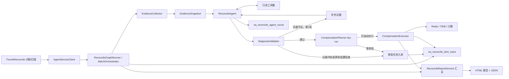

# 项目架构图


## 点赞数据时序图


# 技术选型

## 技术栈选型

* 后端框架：Spring Boot 3 + Java 21
* 数据访问：MyBatis-Plus
* 分布式数据库：TiDB
* 内存数据库: Caffeine
* 缓存系统：Redis Cluster
* 消息队列：Pulsar
* 容器化：Docker
* 负载均衡：Nginx
* 监控系统：Prometheus + Grafana
* 压测工具: JMeter
* 性能分析工具: JProfiler
* 限流组件: Sentinel

## 为什么选用RedisCluster+Pulsar+TiDB架构

| 功能项 | Redis → Pulsar → TiDB | 直接Pulsar → TiDB | Redis + TiDB 同步 | 技术选型分析 |
|--------|----------------------|-------------------|------------------|-------------|
| **架构复杂度** | 较高 | 简单 | 简单 | Redis→Pulsar→TiDB架构相对复杂但职责清晰 |
| **组件耦合度** | 低耦合 | 中等耦合 | 高耦合 | Redis→Pulsar→TiDB各组件职责分离，耦合度最低 |
| **数据流向** | 三级流转 | 二级流转 | 二级流转 | 三级流转提供更好的缓冲和削峰能力 |
| **写入延迟** | 极低(Redis层) | 中等(消息队列) | 高(同步DB) | Redis内存操作提供最低写入延迟 |
| **吞吐能力** | 极高 | 高 | 中等 | Redis层承接瞬时高并发，整体吞吐最优 |
| **资源消耗** | 中等 | 低 | 高 | 三级架构资源消耗适中，性能均衡 |
| **实时一致性** | 最终一致性 | 最终一致性 | 强一致性 | 前两者为最终一致性，Redis+TiDB同步为强一致性 |
| **数据可靠性** | 高 | 高 | 中等 | 前两者通过消息队列保证可靠性，同步方式存在单点风险 |
| **故障恢复** | 自动恢复 | 自动恢复 | 手动干预 | 异步架构具备更好的故障自动恢复能力 |
| **系统容错** | 高 | 高 | 低 | 多级缓冲架构容错能力最强 |
| **组件依赖** | 弱依赖 | 强依赖 | 强依赖 | Redis→Pulsar→TiDB各组件故障影响范围最小 |
| **服务降级** | 支持降级 | 有限降级 | 难降级 | Redis层可独立服务，降级策略丰富 |
| **水平扩展** | 易扩展 | 易扩展 | 难扩展 | 前两者各组件均可独立水平扩展 |
| **扩容影响** | 无影响 | 无影响 | 需要停机 | 异步架构扩容对业务无感知 |
| **高并发场景** | 极佳 | 良好 | 较差 | Redis层完美承接突发流量 |
| **数据追溯** | 支持 | 支持 | 不支持 | 消息队列提供数据重放和能力 |

**选型**
* 在本项目中，因为T0级别为**高并发高可用**，Redis作为第一级存储，提供了**微秒级的内存操作能力**，能够完美承接点赞系统特有的瞬时高并发请求。Pulsar作为和kafka相当的**高并发消息队列**,性能非常优秀。TiDB作为新一代**NewSQL**的代表,功能完备也代表未来SQL发展方向。
* Redis+Pulsar+TiDB对于数据处理的不同**职责充分解耦**,Redis承接高流量读写请求,Pulsar做削峰填谷和异步,TiDB做好数据分片和持久化存储。这三层架构可以**提供极高的容错机制和水平扩展能力**首先从容错机制来说,Redis层故障时可降级到Pulsar直写,Pulsar提供了数据查询的功能,在极限情况下可以承担起数据读取的功能;TiDB层故障时消息自动重试,确保了即使在部分组件异常的情况下，**系统整体仍能保持可用**。然后,就是水平扩展,Redis Cluster通过增加节点自动分片数据；Pulsar基于计算存储分离架构实现无缝扩容；TiDB支持在线弹性扩展。这种**底成本的弹性伸缩方案**可以随着业务流量调整架构复杂度,承接小流量->大流量的各个业务场景的需求。

## RedisCluster和Redis读写集群技术选型

| 功能项 | Redis Cluster | Redis 主从复制+读写分离 | 技术选型分析 |
|--------|---------------|------------------------|-------------|
| **架构模式** | 原生分布式集群 | 主从复制 + 哨兵模式 | Redis Cluster为官方分布式方案，主从复制为传统高可用方案 |
| **数据分片** | 自动分片(16384 slots) | 无分片 | Cluster自动数据分片，主从复制全量数据复制 |
| **写扩展性** | 多主节点写入 | 单主节点写入 | Cluster支持多主写入，大幅提升写性能 |
| **读扩展性** | 多节点读取 | 多从节点读取 | 两者都支持读扩展，Cluster扩展性更强 |
| **数据同步** | 异步复制 | 异步/半同步复制 | 两者都是最终一致性，主从可配置半同步 |
| **数据分区** | 哈希槽分区 | 无分区 | Cluster通过哈希槽实现数据分布 |
| **跨节点事务** | 不支持 | 不支持 | 两者都不支持跨节点事务 |
| **故障转移** | 自动故障转移 | 哨兵自动切换 | 两者都支持自动故障转移 |
| **故障恢复时间** | 秒级 | 秒级 | 故障检测和切换时间相近 |
| **数据可靠性** | 多副本保障 | 多副本保障 | 两者都通过副本保证数据安全 |
| **写入吞吐量** | 线性扩展 | 单主瓶颈 | Cluster写性能随节点数线性增长 |
| **读取吞吐量** | 线性扩展 | 线性扩展 | 两者读性能都可线性扩展 |
| **跨节点操作** | 需要重定向 | 无跨节点操作 | Cluster跨节点操作有额外开销 |
| **部署复杂度** | 中等 | 简单 | Cluster部署和配置相对复杂 |
| **监控管理** | 需要集群管理工具 | 相对简单 | Cluster监控需要关注更多指标 |
| **数据迁移** | 自动数据平衡 | 手动数据同步 | Cluster支持自动数据迁移 |
| **客户端支持** | 需要集群感知客户端 | 普通客户端即可 | Cluster需要特殊客户端支持 |

**选型：** 在本项目中，因为首要设计为承接高并发高可用，Redis Cluster是支持分片的，在多个分片上可以并发的进行读写操作，可以极高的提升性能。而且Redis Cluster是去中心化的，相比于读写集群降低了单点故障带来的影响，所以选用Redis Cluster。

## Pulsar和Kafka技术选型

[Pulsar官方文档](https://pulsar.apache.org/docs/4.1.x/)

| 功能项 | Pulsar | Kafka | 技术选型分析 |
|--------|--------|-------|-------------|
| **消费推拉模式** | push | pull | Pulsar服务端推送提供更高实时性 |
| **延迟队列** | 支持 | 不支持 | Pulsar提供延迟消息，Kafka需自行实现 |
| **死信队列** | 支持 | 不支持 | Pulsar提供完善的重试和死信机制 |
| **优先级队列** | 不支持 | 不支持 | 两者均不支持消息优先级 |
| **消息回溯** | 支持 | 支持 | 两者都支持按偏移量重新消费 |
| **消息持久化** | 支持 | 支持 | 两者都提供持久化保证 |
| **消息确认机制** | Offset + 单条确认 | Offset 确认 | Pulsar支持更细粒度的消息确认 |
| **消息TTL** | 支持 | 不支持 | Pulsar支持消息消费超时后自动过期 |
| **多租户隔离** | 支持 | 不支持 | Pulsar原生支持多租户 |
| **消息顺序性** | 流模式有序 | 分区有序 | Pulsar流模式全局有序，Kafka仅分区有序 |
| **消息查询** | 支持 | 不支持 | Pulsar支持按属性查询消息 |
| **消息模式** | 流模式 + 队列模式 | 流模式 | Pulsar支持更丰富的消息模式 |
| **消息可靠性** | Ack Quorum Size(Qa) | request.required.acks | 两者都提供可配置的可靠性级别 |
| **单机吞吐量** | 百万级QPS | 百万级QPS | 两者在吞吐量方面性能相当 |
| **消息延迟** | ms级 | ms级 | 两者延迟表现相近 |
| **支持主题数** | 上百万个 | 几十到几百 | Pulsar支持海量主题，Kafka在海量主题时性能严重受损 |
| **高可用** | 分布式架构 | 分布式架构 | 两者都提供高可用保证 |
| **跨地域容灾** | 支持 | 不支持 | Pulsar内置多地域复制功能 |
| **集群扩容** | 增加节点，通过新增分片负载均衡 | 增加节点，通过复制数据均衡 | Pulsar扩容更平滑，无需数据重平衡 |

**选型：** 在本项目中，Pulsar对于高并发高可用需求支持能力更强，原生提供延迟队列和死信队列支撑更丰富的业务场景，计算和存储分离架构以及Broker无状态的服务机制提供更简单的水平扩容能力，支持百万级别的Topic，相比于Kafka可用性更强。并且Pulsar对于云原生提供很强的支持性，而云原生也是未来的发展趋势。因此本项目选择Pulsar作为MQ。

## TiDB和MySQL+ShardingJDBC技术选型

[TiDB官方文档](https://docs.pingcap.com/zh/tidb/stable/overview/?source=welcome)

| 功能项 | TiDB | MySQL + ShardingJDBC | 技术选型分析 |
|--------|------|---------------------|-------------|
| **架构模式** | 原生分布式NewSQL | 单机数据库 + 应用层分片 | TiDB原生分布式，ShardingJDBC为中间件方案会引入一层负载降低性能 |
| **数据分片** | 自动分片 | 手动分片配置 | TiDB自动管理分片，ShardingJDBC需预先规划 |
| **计算存储分离** | 支持 | 不支持 | TiDB可独立扩展计算和存储节点 |
| **SQL兼容性** | MySQL 5.7协议兼容 | 原生MySQL兼容 | 都高度兼容MySQL语法 |
| **水平扩展** | 在线弹性扩展 | 支持但需停机 | TiDB扩容无感知，ShardingJDBC扩容复杂 |
| **扩展粒度** | 细粒度(计算存储分离架构) | 粗粒度(整个分片) | TiDB扩展更灵活 |
| **最大数据量** | PB级别 | TB级别 | TiDB适合海量数据场景 |
| **分布式事务** | 支持(乐观锁) | 支持(最终一致性) | TiDB提供强一致性事务 |
| **跨分片查询** | 透明支持 | 支持但性能有损 | TiDB自动优化分布式查询 |
| **全局索引** | 支持 | 不支持 | TiDB支持跨节点的全局索引 |
| **读写性能** | 高并发读写 | 高并发读，写受分片限制 | TiDB写性能更优 |
| **复杂查询** | 优化器智能优化 | 需要手动优化分片查询 | TiDB对复杂查询支持更好 |
| **热点处理** | 自动热点Region调度 | 手动分片键调整 | TiDB自动负载均衡 |
| **故障恢复** | 自动故障转移 | 依赖主从复制 | TiDB Raft协议保证高可用 |
| **数据备份** | 分布式快照 | 传统备份方式 | TiDB备份更高效 |
| **多活部署** | 支持 | 有限支持 | TiDB原生支持多数据中心 |
| **部署复杂度** | 中等 | 简单到复杂 | 简单场景MySQL更易部署 |
| **日常运维** | 自动化运维 | 手动分片管理 | TiDB运维更自动化 |
| **监控告警** | 完善监控体系 | 需要自行搭建 | TiDB监控更全面 |

**选型：** 在本项目高并发场景中，分布式NewSQL代替MySQL集群，可以实时在线扩容，支撑业务从零到亿级用户的完整生命周期。原生分布式设计，性能更优。多副本自动故障转移，业务不停机，可以实现服务高可用。自动热点调度，应对突发流量。

# 具体实现

## 为什么要做点赞系统

从业务方面来看，点赞系统是社交平台和内容社区最核心的互动功能之一，具有极高的使用范围和技术代表性。虽然点赞功能表面简单，但其"读多写多"的业务特性使其成为典型的高并发场景，能够很好地模拟真实互联网业务中的技术挑战。从技术学习角度，这个项目涵盖了现代分布式系统的完整技术栈,更重要的是，点赞系统的技术方案具有很好的普适性，其架构设计和优化思路可以复用到收藏、关注、投票等众多类似业务场景中，具备很高的实用价值。

## JVM参数配置

```bash
-Xms4g
-Xmx4g
-XX:+UseG1GC
-XX:+UseFastEmptyMethods                 
-XX:+UseFastJNIAccessors              

#日志
-XX:+PrintGC
-XX:+PrintGCDetails
-XX:+PrintGCDateStamps
-XX:+PrintGCTimeStamps
-XX:+PrintGCApplicationStoppedTime
-XX:+PrintGCApplicationConcurrentTime
-XX:+PrintTenuringDistribution
-XX:+PrintAdaptiveSizePolicy
-Xloggc:/opt/logs/gc.log

#元空间
-XX:MetaspaceSize=256M
-XX:MaxMetaspaceSize=256M
-XX:+UseCompressedClassPointers
-XX:+UseCompressedOops

#G1
-XX:G1HeapRegionSize=4m
-XX:MaxGCPauseMillis=200
-XX:ParallelGCThreads=8                   
-XX:ConcGCThreads=4                    
-XX:G1NewSizePercent=30
-XX:G1MaxNewSizePercent=60
-XX:G1HeapWastePercent=5
-XX:G1MixedGCCountTarget=8
-XX:G1MixedGCLiveThresholdPercent=85
-XX:G1RSetUpdatingPauseTimePercent=10
-XX:InitiatingHeapOccupancyPercent=35
-XX:+G1UseAdaptiveIHOP
-XX:G1ReservePercent=15

#直接内存
-XX:MaxDirectMemorySize=1g
-XX:+DisableExplicitGC

#逃逸分析
-XX:+DoEscapeAnalysis
-XX:+EliminateAllocations
-XX:+EliminateLocks
-XX:+UseBiasedLocking
-XX:BiasedLockingStartupDelay=0

#JIT
-XX:+TieredCompilation
-XX:CompileThreshold=10000
-XX:ReservedCodeCacheSize=256m
-XX:InitialCodeCacheSize=64m
-XX:+PrintCompilation

#方法内联
-XX:MaxInlineSize=35
-XX:FreqInlineSize=325
-XX:InlineSmallCode=1000
-XX:+InlineSynchronizedMethods
```

### 部分核心JVM参数解析

**-XX:MaxGCPauseMillis=200**
* 控制最大停顿时间

**-XX:InitiatingHeapOccupancyPercent=35**
* 控制IHOP触发阈值,尽量避免Eden区填满导致的Full GC

**-XX:+TieredCompilation**
*  结合C1和C2编译器优势，平衡启动速度和运行性能

**-XX:+UseCompressedOops**
* 启用普通对象指针压缩,对于大数据量小对象的点赞系统来说,可以明显优化性能

**-XX:+UseCompressedClassPointers**
* 启用压缩类指针

## RedisCluster配置

```yaml
spring:
  redis:
    cluster:
      nodes:
        - redis-node1:6379
        - redis-node2:6379
        - redis-node3:6379
      max-redirects: 3
    lettuce:
      pool:
        max-active: 8
        max-wait: -1ms
        max-idle: 8
        min-idle: 0
      cluster:
        refresh:
          adaptive: true
          period: 2000

```

## AI结合：Agent辅助对账与异常处理

在 Redis → Pulsar → TiDB 的最终一致性链路上，AI Agent 不直接替代业务链路，也不直接执行任意写操作，而是作为**对账差异分析与受控补偿编排层**：先采集可验证证据，再由 LLM 分析异常，最后由确定性代码完成校验、审批分流和执行。

### AI能力定位

| 能力 | 作用 | 是否允许 LLM 直接执行 |
| --- | --- | --- |
| 证据采集 | 查询 Redis、DB、DLQ、重试任务和日志 | 只读 |
| 异常诊断 | 分析差异原因，输出 A1-A8 分类和置信度 | 是 |
| 证据校验 | 验证 evidenceId、字段和值是否真实存在 | 否，由规则代码执行 |
| 补偿计划 | 根据诊断生成 dry-run 计划 | 否，由规则代码执行 |
| 审批分流 | 低置信度、高风险或规则降级时生成审批任务 | 否，由规则代码执行 |
| 补偿执行 | 写 DB、写 Redis、删除 Redis或重算计数 | 否，只允许 Executor 执行 |
| 汇总追踪 | 记录每条差异、每轮诊断和最终结果 | 否，由数据库和报告服务记录 |

### AI对账核心链路



### 单条差异处理流程

1. 对账任务产生 `ReconcileDiffItem`，通过 `AgentServiceClient#batchExecute` 进入 Agent。
2. `EvidenceCollector` 采集 Redis 和 DB 核心状态，并按需补充 DLQ、重试表和日志证据。
3. `ReconcileAgent` 使用 Spring AI 调用模型，只注册 `ReconcileReadTools` 只读工具。
4. `DiagnosisValidator` 校验模型输出，包括分类白名单、置信度、证据引用和 Redis/DB 状态一致性。
5. 低置信度时最多进行两轮 Agent 诊断：
   - 证据不足：第一轮允许补充一次证据。
   - 证据冲突：立即停止 Agent，转人工审批。
   - 第二轮后仍低置信度：无论原因是什么，都转人工审批。
6. `CompensationPlanner` 根据合法诊断生成补偿计划，并强制调用 `dryRun=true`。
7. 可自动执行的计划进入 `CompensationExecutor`；需要人工的计划规范化写入 `ea_compensation_approval`。
8. 每条差异最终写入 `ea_reconcile_item_trace`，每轮 Agent 诊断写入 `ea_reconcile_agent_round`。

批次入口由 `AgentServiceClient#batchExecute(ReconcileDiffBatch)` 承接：空批次返回空结果，异常在入口兜底并记录失败结果，不向上中断对账任务。单批最多 100 条，批内串行以保持同一用户差异的处理顺序，跨批并发受控；每条差异独立捕获异常并立即持久化明细，因此单条失败不影响后续条目，批次中断也不丢失已完成结果。重复 `diffKey` 在幂等窗口内跳过。

Agent 的工具调用最多 6 轮，单工具超时 800ms；低置信度时允许按证据不足情况补充一次证据，证据冲突或补充后仍无法通过校验则转人工。工具调用轮次与诊断补充轮次是不同限制，不应混为同一个“两轮上限”。

### 只读工具边界

LLM 只允许使用以下工具：

| 工具 | 用途 |
| --- | --- |
| `queryThumbEvidence` | 一次查询 Redis 状态、DB 明细和博客计数 |
| `queryDlqMessages` | 查询死信消息、`messageId`、`eventId` 和 payload |
| `queryRetryTasks` | 查询 `biz_retry_task` 的状态、重试次数和错误信息 |
| `queryLogs` | 查询指定业务键、事件或错误关键字的日志 |

`insertDbThumb`、`insertRedisThumb`、`deleteRedisThumb` 和 `recomputeDbThumbCount` 等写工具不会注册给 LLM，只能由 `CompensationExecutor` 在计划校验和 dry-run 成功后调用。

### A1-A8异常诊断

| 分类 | 典型现象 | AI处理建议 |
| --- | --- | --- |
| A1 | Redis 写成功，Pulsar 发送失败 | 记录生产端失败并告警 |
| A2 | DLQ 消息对应记录已存在 DB | 幂等成功，跳过补偿 |
| A3 | DB 缺失、Redis 状态存在，且有重试或 DLQ 证据 | 校验后补写 DB |
| A4 | Redis、DB 或关键上下文不足 | 人工审查 |
| A5 | 对账发现 Redis 有、DB 无 | 生成补写 DB 计划 |
| A6 | 对账发现 DB 有、Redis 无 | 默认人工确认或回填 Redis，不自动删 DB |
| A7 | 同一 `bizKey` 事件乱序或重复 | 去重并视影响范围人工处理 |
| A8 | DB 提交超时，实际状态未知 | 先回查 DB，再决定是否补偿 |

模型输出必须包含：

```json
{
  "evidenceId": "ev-...",
  "classification": "A1..A8",
  "confidence": 0.0,
  "summary": "诊断摘要",
  "evidenceRefs": [
    {
      "evidenceId": "ev-...",
      "field": "db.thumbExists",
      "value": "false",
      "meaning": "DB不存在对应点赞明细"
    }
  ],
  "proposedAction": "WRITE_DB | REBUILD_REDIS | SKIP | ESCALATE",
  "needHuman": false
}
```

模型输出只是建议，不能绕过确定性校验。引用的 `evidenceId`、字段和值必须在当前快照中真实存在。

### 审批与补偿执行

审批由 `CompensationApprovalService` 完成，不设置独立 `Governance` 业务节点。批次并发、单条耗时、工具轮次和模型调用均应按配置设限；审批规则包括：

- `needHuman=true`、规则降级、低置信度：单人审批。
- A6、A8：单人审批。
- 高风险动作或 A7：双人审批。
- 审批记录以 `idempotency_key` 唯一，重复提交不会重复建单。
- 审批通过后必须重新采集 Redis/DB 状态，不能直接执行旧计划。
- `CompensationExecutor` 返回的执行成功只代表写动作成功，一致性由下一轮对账复核。

自动执行只允许以下动作：

| 动作 | 说明 |
| --- | --- |
| `WRITE_DB` | 插入点赞明细并重算 `blog.thumbCount` |
| `REBUILD_REDIS` | 根据 DB 状态回填 Redis |
| `DELETE_REDIS` | 确认 Redis 为脏状态后删除 |
| `RECOMPUTE_COUNT` | 按 DB 明细重算博客点赞数 |

### 可追溯记录

每条差异必须有完整处理记录，终态包括：

```text
SUCCESS
SKIPPED
PENDING_APPROVAL
REJECTED
FAILED
```

`ea_reconcile_item_trace` 保存：

- `graphRunId`、`threadId`、`batchNo`、`diffKey`
- 当前节点和最终状态
- `evidenceId`、`evidenceHash`
- 分类、置信度、校验结果
- `planId`、动作、幂等键
- 审批单号和执行结果
- 失败码、失败消息和处理时间

`ea_reconcile_agent_round` 保存每轮 Agent 诊断：

- 轮次、证据快照和证据哈希
- 分类、置信度和低置信度原因
- 校验状态和校验原因
- prompt 版本、解析状态、原始输出摘要

这样可以追踪“这条差异为什么被分类、引用了什么证据、是否补充过证据、是否审批、最终是否执行”。

批次处理结果同时汇总为对账报告。报告包含 `reportId`、`batchNo`、触发来源、起止时间、耗时和整体状态（`COMPLETED`、`COMPLETED_WITH_PENDING`、`DEGRADED`、`FAILED`），并按差异类型、Agent 分类、最终分类、动作、执行状态和校验状态统计分布。LLM 使用统计记录调用次数、Token、平均耗时及规则降级次数。

每条报告明细关联 `diffKey`、证据快照及哈希、模型原始分类与最终分类、置信度、校验原因、计划和 dry-run 预览、审批状态、执行状态、错误信息及追溯链接。报告明细应在每条差异处理后立即保存；报告中的执行成功仅表示写动作成功，一致性状态标记为 `PENDING_NEXT_RECONCILE`，由下一轮对账自然复核，不另建延迟验证器。若同一差异再次出现，可标记 `RECURRING` 并累计出现次数用于告警。

报告提供单文件 HTML 与 JSON：概览展示总差异、执行、待审批、失败、证据缺失、降级和 Token 消耗；明细支持按差异类型、最终分类、动作、执行结果和校验状态筛选，并可按用户或博客检索。每条明细可展开证据快照、Agent 分析和执行结果三个视图，内容全部来自报告持久化数据，页面不二次查询业务库；HTML 内嵌 JSON，可离线打开，另导出 `{batchNo}.json` 供程序消费。

### 生产注意事项

1. LLM 只读取证据，不直接访问业务库写接口。
2. 日志、DLQ payload 和异常堆栈均视为不可信数据，不能改变系统提示词。
3. 证据不足不能当作业务状态为 false。
4. 单条工具循环最多 6 轮；低置信度补充诊断最多一次，避免无限调用模型和工具。
5. Graph checkpoint 用于恢复，数据库追踪表用于审计，二者不能互相替代。
6. 当前执行幂等集合仍是进程内实现，多实例生产环境应迁移到 Redis `SETNX` 或数据库唯一约束。
7. 自动补偿前必须保证 `dryRun` 已成功，审批恢复时必须重新校验实时状态。
8. Agent 不可用时，主业务链路不能回退为直接写 Redis/DB；应保留失败或待审批记录。
9. LLM 超时、限流或输出不可解析时进入规则降级，置信度封顶 0.75 并强制审批；关键证据缺失或引用无效时禁止自动执行。
10. 报告中的证据、工具调用轨迹和原始输出摘要均来自持久化数据；日志及 DLQ 内容不得作为指令执行。

### 当前代码落地情况

已实现的核心类包括：

- `ReconcileGraphRunner`
- `EvidenceCollector`
- `ReconcileAgent`
- `DiagnosisValidator`
- `CompensationPlanner`
- `CompensationApprovalService`
- `CompensationExecutor`
- `ReconcileTraceService`

LangGraph4J 的业务状态、节点和条件边已经按 Graph 语义实现为项目内 Runner。后续接入具体 LangGraph4J 版本时，主要替换 Graph 容器和 checkpoint 适配，不改变上述业务节点和安全边界。

